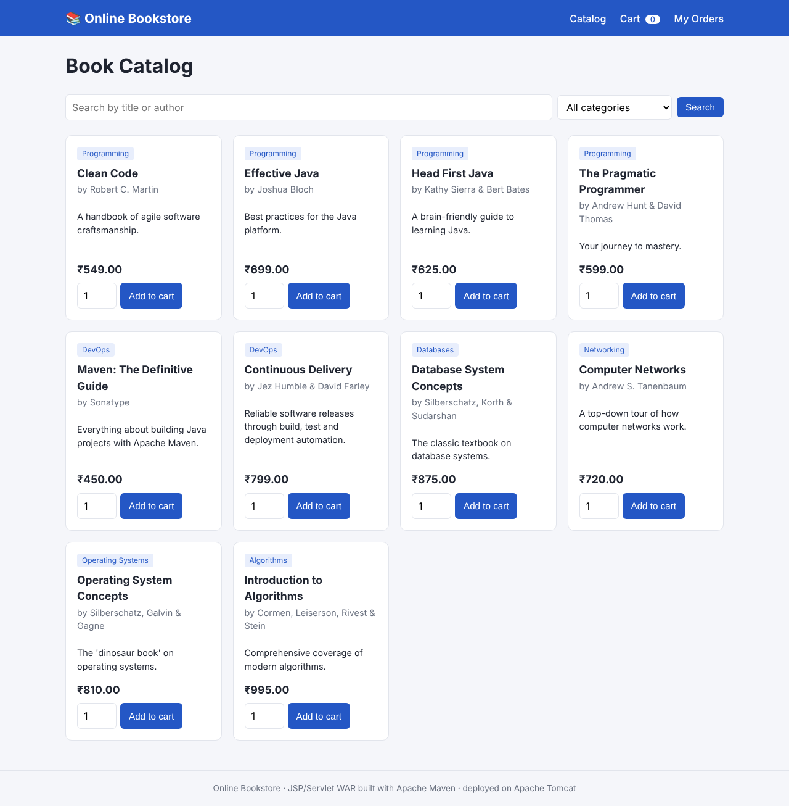

# Online Bookstore – Build Automation with Maven (WAR on Tomcat)

**Aim:** Automate the software build process using Maven and generate a deployable
application artifact (`bookstore.war`).

**Problem:** The development team compiled and packaged the application by hand
(running `javac`, copying class files, zipping folders). Manual builds are
inconsistent, error-prone and slow, which causes failures and delays during deployment.

**Solution:** One Maven command, `mvn clean package`, compiles the code, runs the unit
tests and packages a ready-to-deploy WAR file the same way every time. The WAR is then
deployed to Apache Tomcat, either by copying it into `webapps/` or straight from Maven
with the Cargo plugin.



---

## 1. The application

A JSP/Servlet online bookstore with:

| Page | URL | What it does |
|------|-----|--------------|
| Book catalog | `/bookstore/books` | Lists books, search by title/author, filter by category, add to cart |
| Cart | `/bookstore/cart` | Change quantities, remove items, clear cart, see the total |
| Checkout | `/bookstore/checkout` | Name, email and address form with validation |
| Order confirmation | `/bookstore/orders?id=1001` | Shows the placed order |
| My orders | `/bookstore/orders` | All orders placed in this session |

Screenshots: [cart](docs/screenshots/cart.png) ·
[checkout](docs/screenshots/checkout.png) ·
[order confirmation](docs/screenshots/order-confirmation.png)

The data is kept in memory, so no database setup is needed for the demo.

### Project structure (standard Maven layout)

```
online-bookstore/
├── pom.xml                         <- build definition (packaging = war)
├── mvnw, mvnw.cmd, .mvn/           <- Maven Wrapper (works without installing Maven)
├── src/main/java/com/bookstore/
│   ├── model/        Book, Cart, CartItem, Order
│   ├── repository/   BookRepository (catalog), OrderRepository
│   └── servlet/      CatalogServlet, CartServlet, CheckoutServlet, OrderServlet
├── src/main/webapp/
│   ├── index.jsp                   <- redirects to /books
│   ├── css/style.css
│   └── WEB-INF/
│       ├── web.xml
│       └── views/                  <- catalog, cart, checkout, orders JSPs
├── src/test/java/                  <- JUnit 5 tests (run automatically by Maven)
├── demo/manual-build.sh / .bat     <- the old MANUAL way, for comparison
└── scripts/deploy.sh / .bat        <- mvn package + copy WAR to Tomcat
```

---

## 2. Requirements

| Tool | Version | Notes |
|------|---------|-------|
| JDK | 25 or newer (Java 25 is the current LTS) | `java -version` |
| Maven | 3.6+ (optional) | If Maven isn't installed, use `./mvnw` (Linux/Mac) or `mvnw.cmd` (Windows) instead of `mvn` |
| Apache Tomcat | **10.1.x** or 11.x | Download the zip from https://tomcat.apache.org/ |

> Tomcat 9 or older will **not** work. This project uses the Jakarta EE
> (`jakarta.servlet`) APIs, which need Tomcat 10 or newer.

---

## 3. Key parts of `pom.xml`

```xml
<packaging>war</packaging>                 <!-- produce a WAR, not a JAR -->

<dependency>                               <!-- provided: Tomcat already has it, -->
  <artifactId>jakarta.servlet-api</artifactId>   <!-- so it is NOT copied into the WAR -->
  <scope>provided</scope>
</dependency>

<dependency>                               <!-- compile scope: Maven downloads the JSTL -->
  <artifactId>jakarta.servlet.jsp.jstl</artifactId>  <!-- jar and copies it into WEB-INF/lib -->
</dependency>

<finalName>bookstore</finalName>           <!-- output: target/bookstore.war -->

<plugin>
  <artifactId>maven-war-plugin</artifactId> <!-- assembles the WAR -->
</plugin>

<plugin>
  <artifactId>cargo-maven3-plugin</artifactId> <!-- optional: deploy/run Tomcat from Maven -->
</plugin>
```

What `mvn clean package` does, phase by phase:

```
clean      -> delete the old target/ folder
validate   -> check that pom.xml is correct
compile    -> javac src/main/java  -> target/classes
test       -> compile and run the JUnit tests (the build FAILS if a test fails)
package    -> maven-war-plugin builds target/bookstore.war
```

---

## 4. Demo script (for the presentation)

### Step A – the manual way (the problem)

```bash
# Linux / Mac
CATALINA_HOME=/path/to/apache-tomcat-10.1.x ./demo/manual-build.sh

# Windows
set CATALINA_HOME=C:\apache-tomcat-10.1.x
demo\manual-build.bat
```

The script shows the six manual steps: find `servlet-api.jar`, clean the folder, run
`javac` on every file, copy the JSPs, CSS and `web.xml`, copy the JSTL jars by hand, and zip
with `jar -cf`. Points to make:

- Paths and library versions are hard-coded, and they differ on every developer's PC.
- If you forget the JSTL jars in step 5, the WAR still builds but **fails at runtime**.
- No tests are run, so broken code can still be packaged and shipped.
- The steps are easy to get wrong, so builds come out different each time.

> Step 5 copies the JSTL jars from the local Maven repository, so run
> `mvn package` once before the manual script. That itself shows how much
> work Maven's dependency management saves you.

### Step B – the automated way (the solution)

```bash
mvn clean package          # or ./mvnw clean package   /   mvnw.cmd clean package
```

Output:

```
[INFO] Tests run: 11, Failures: 0, Errors: 0, Skipped: 0
[INFO] Building war: .../target/bookstore.war
[INFO] BUILD SUCCESS
```

One command compiles the code, runs the tests, downloads the dependencies and builds
`target/bookstore.war`, and it does this the same way on every machine.

You can look inside the WAR to show its structure:

```bash
jar -tf target/bookstore.war
```

### Step C – deploy the WAR to Tomcat's `webapps` folder

**Option 1: copy by hand**

```bash
cp target/bookstore.war $CATALINA_HOME/webapps/          # Windows: copy target\bookstore.war %CATALINA_HOME%\webapps\
$CATALINA_HOME/bin/startup.sh                            # Windows: %CATALINA_HOME%\bin\startup.bat
```

**Option 2: use the deploy script** (builds and copies in one go)

```bash
CATALINA_HOME=/path/to/tomcat ./scripts/deploy.sh        # Windows: scripts\deploy.bat
```

Tomcat unpacks the WAR automatically. Open **http://localhost:8080/bookstore/**

### Step D (optional) – deploy straight from Maven with Cargo

**Run in an embedded Tomcat** (Maven downloads Tomcat 10.1 for you, no installation needed):

```bash
mvn clean package cargo:run
```

Open http://localhost:8080/bookstore/ and press `Ctrl+C` to stop.

**Deploy to a Tomcat that is already running** (uses the Tomcat Manager):

1. Add a manager user to `$CATALINA_HOME/conf/tomcat-users.xml`, then restart Tomcat:
   ```xml
   <user username="admin" password="admin" roles="manager-script,manager-gui"/>
   ```
2. Deploy (or redeploy) with:
   ```bash
   mvn clean package cargo:redeploy -Premote -Dtomcat.username=admin -Dtomcat.password=admin
   ```

---

## 5. Manual vs. Maven – comparison

| | Manual build | Maven build |
|---|---|---|
| Commands | 6+ steps, typed by hand | `mvn clean package` |
| Dependencies | Find and copy jars yourself | Declared in `pom.xml`, downloaded automatically |
| Tests | Usually skipped | Run on every build, and a failing test stops the build |
| Consistency | Depends on the developer's machine | Same result everywhere |
| Output | Folder layout can be wrong | Standard WAR layout every time |
| Deployment | Copy the WAR by hand | Copy the WAR, or `cargo:run` / `cargo:redeploy` |

---

## 6. Useful commands

```bash
mvn clean            # delete target/
mvn compile          # compile only
mvn test             # compile and run the unit tests
mvn package          # build target/bookstore.war
mvn clean package -DskipTests   # build without running tests (not recommended)
mvn cargo:run        # run on Tomcat from Maven (after package)
```

## 7. Troubleshooting

| Problem | Fix |
|---------|-----|
| `404` at `/bookstore` | Wait a few seconds for Tomcat to unpack the WAR, and check `logs/catalina.out` |
| `ClassNotFoundException: javax.servlet...` / app does not start | You are using Tomcat 9. Use Tomcat 10.1+ |
| Port 8080 already in use | Stop the other server, or run `mvn cargo:run -Dtomcat.port=9090` |
| `mvn` not found | Use `./mvnw` (Linux/Mac) or `mvnw.cmd` (Windows) |
| `cargo:redeploy` returns 401/403 | Check the `manager-script` user in `tomcat-users.xml` |
